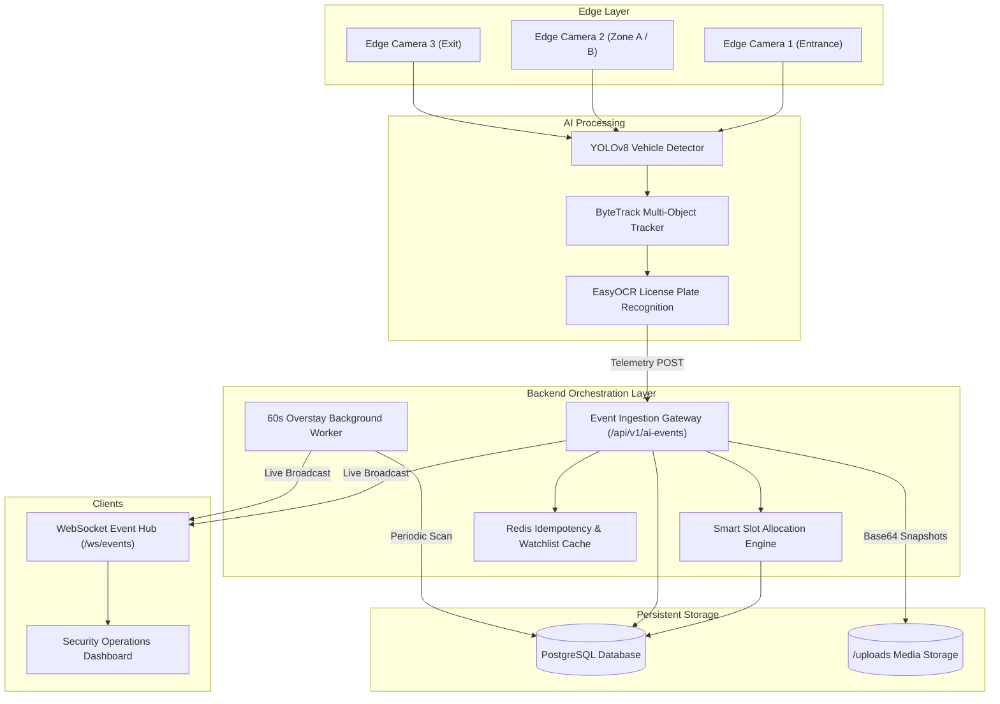

# Backend Service Architecture & Pipeline Data Flow

Architectural specification of the AI-driven CCTV parking backend service orchestration.

## Core Service Layers

1. **Edge Ingestion Pipeline**:
   - Ingests canonical frame events: `entry`, `plate`, `parked`, `exit`, `crash`, `wrong_parking`.
   - Thread-safe deduplication with Redis TTL guarantees zero duplicate session records.

2. **Smart Allocation Engine**:
   - Queries available slots within the targeted zone.
   - Applies strict category fallback rules to optimize lot utilization.

3. **Background Overstay Daemon**:
   - Runs asynchronously every 60 seconds.
   - Flags active vehicles exceeding configurable duration thresholds.
