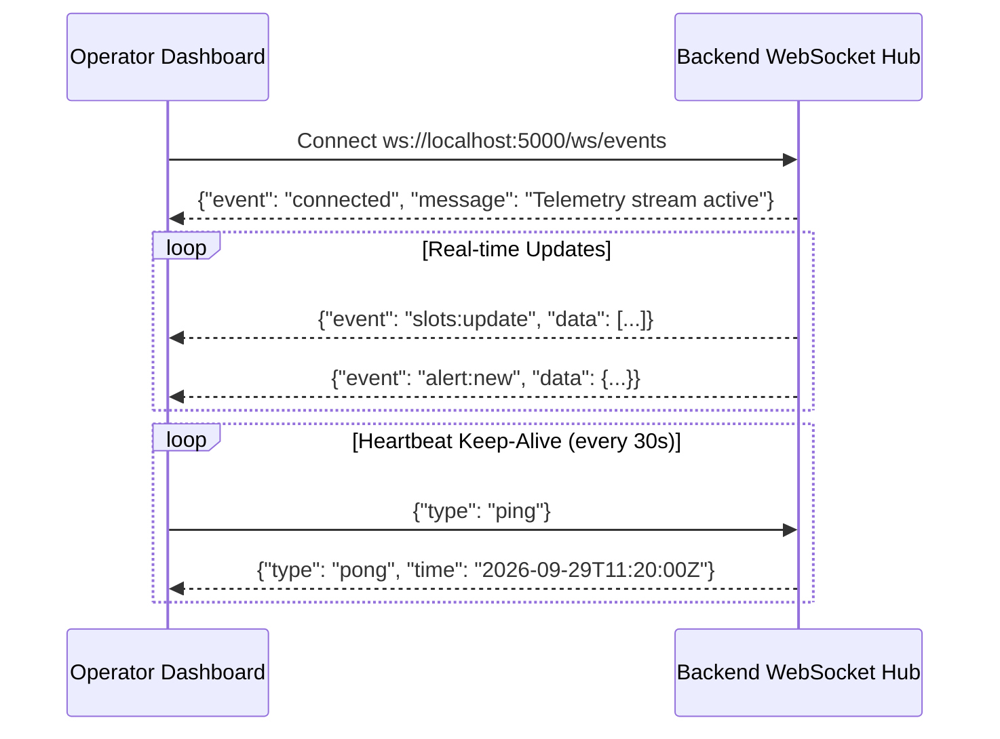

# WebSocket Real-Time Telemetry Protocol Specification

Real-time WebSocket protocol specification for `/ws/events`.

## Connection Endpoint
- **URL**: `ws://localhost:5000/ws/events`
- **Subprotocols**: `json`

## Handshake Lifecycle


## Standard Event Payloads

### 1. `alert:new`
```json
{
  "event": "alert:new",
  "data": {
    "alert_id": "8f3b12dc-4a5e-4c77-90bc-2e917d52a912",
    "alert_type": "STOLEN_VEHICLE",
    "severity": "HIGH",
    "plate_number": "RJ14AB1234",
    "slot_id": "A-01",
    "camera_id": "cam-1",
    "snapshot_url": "/uploads/snap-1727608800.jpg",
    "message": "CRITICAL: Stolen vehicle detected at entry gate.",
    "is_acknowledged": false,
    "created_at": "2026-09-29T11:20:00Z"
  }
}
```

### 2. `slots:update`
Broadcasts updated status array whenever slot occupancy changes.
