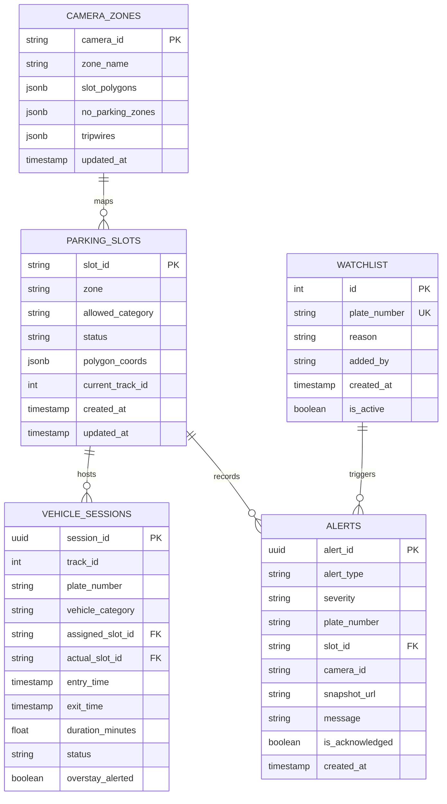

# Database Entity Relationship Specification

Comprehensive entity-relationship model and schema specifications for the AI-Powered Smart CCTV Parking & Safety System.

## Architecture Overview
The relational data store manages high-throughput edge telemetry, vehicle lifecycle sessions, security watchlists, and safety incident alerts.

## Entity Specifications & Constraints

### 1. `parking_slots`
- **Primary Key**: `slot_id` (e.g., `A-01`, `B-04`).
- **Allowed Categories**:
  - `TWO_WHEELER`: Standard motorcycle / scooter slots.
  - `COMPACT_CAR`: Standard sedans and hatchbacks.
  - `SUV_SEDAN`: Mid-to-full size SUVs and larger sedans.
  - `HEAVY_VEHICLE`: Delivery trucks, buses, maintenance transports.
- **Occupancy Status**: `AVAILABLE`, `RESERVED`, `OCCUPIED`, `VIOLATION`.

### 2. `vehicle_sessions`
- **Lifecycle Tracking**:
  - Tracks vehicle from entrance tripwire crossing (`entry_time`) to parking slot allocation and final lot departure (`exit_time`).
  - `duration_minutes` is automatically computed at checkout.

### 3. `watchlist`
- **Index**: Unique B-tree index on `plate_number`.
- Plates stored normalized in uppercase without spaces or punctuation.

### 4. `alerts`
- High-priority security and safety logs: `STOLEN_VEHICLE`, `ACCIDENT`, `WRONG_PARKING`, `OVERSTAY`.
