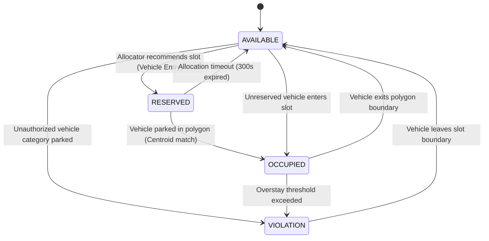

# Parking Slot State Machine and Transition Rules

Comprehensive state machine specification defining atomic state transitions for parking spaces.

## State Definitions

1. **`AVAILABLE`**:
   - The slot is unoccupied and free for allocation by the smart allocation engine.
   - Eligible for immediate assignment to arriving vehicles.

2. **`RESERVED`**:
   - Temporarily allocated to an incoming vehicle detected at the entry gate.
   - Enforces a 5-minute (300 seconds) reservation lock.
   - If the vehicle fails to park within the TTL, the slot automatically transitions back to `AVAILABLE`.

3. **`OCCUPIED`**:
   - The vehicle tracking module confirms vehicle centroid intersection with slot polygon.
   - Slot is marked occupied and excluded from recommendations.

4. **`VIOLATION`**:
   - Vehicle category mismatch (e.g., Heavy truck occupying a two-wheeler slot) or vehicle parked across lines.
   - Generates a high-severity alert for immediate parking operator notification.
