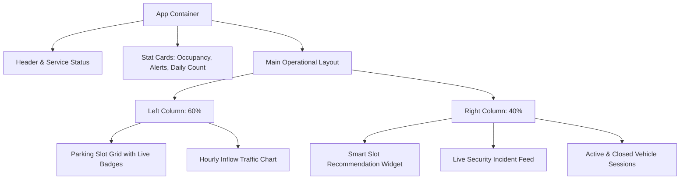

# Dashboard UI/UX Wireframe & Component Hierarchy

High-level architecture and wireframe specifications for the Real-time Parking Management Dashboard.

## Component Breakdown
1. **HeaderBar**: Live WebSocket connection badge, current system time, camera selector.
2. **SummaryCards**: Quick counters for Total, Free, Occupied, Overstay, and Open Alerts.
3. **SlotGrid**: 2D floorplan visualization with category indicators.
4. **AlertFeed**: Prioritized notifications with snapshot previews.
